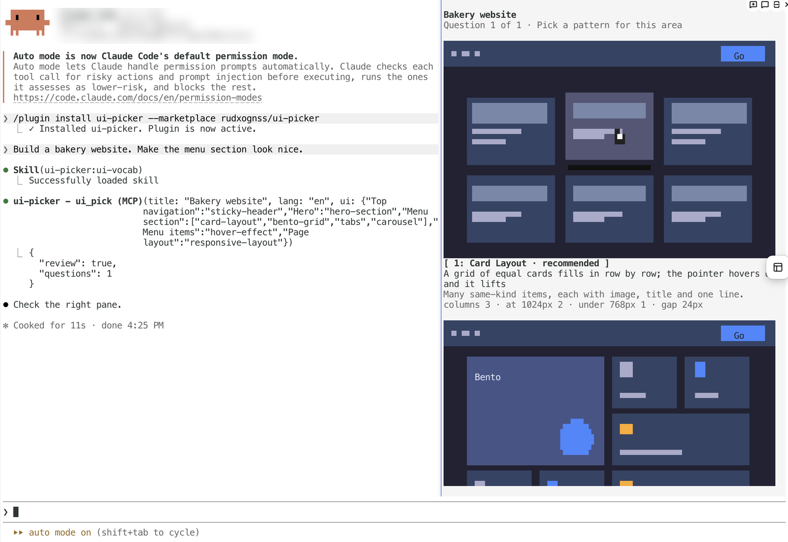
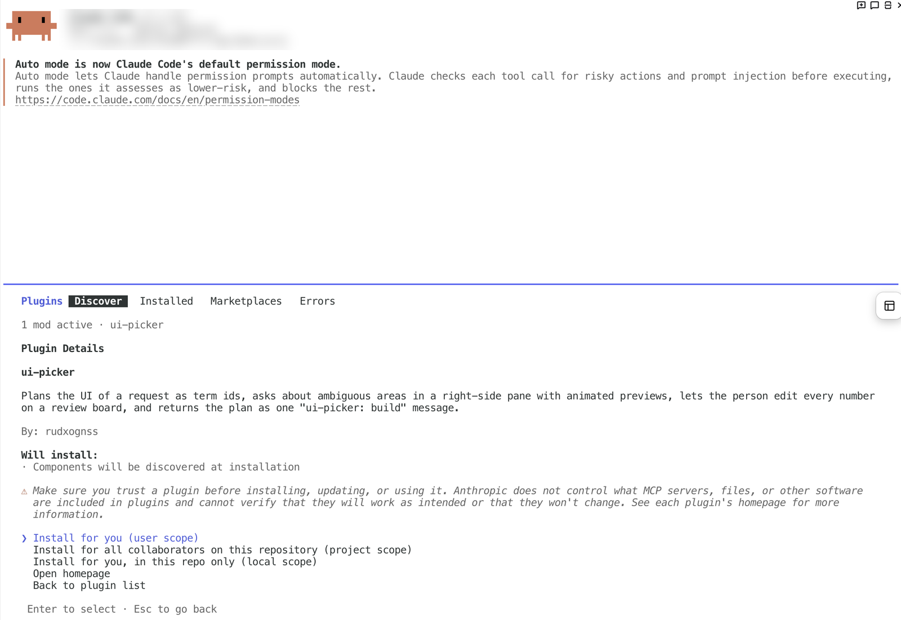
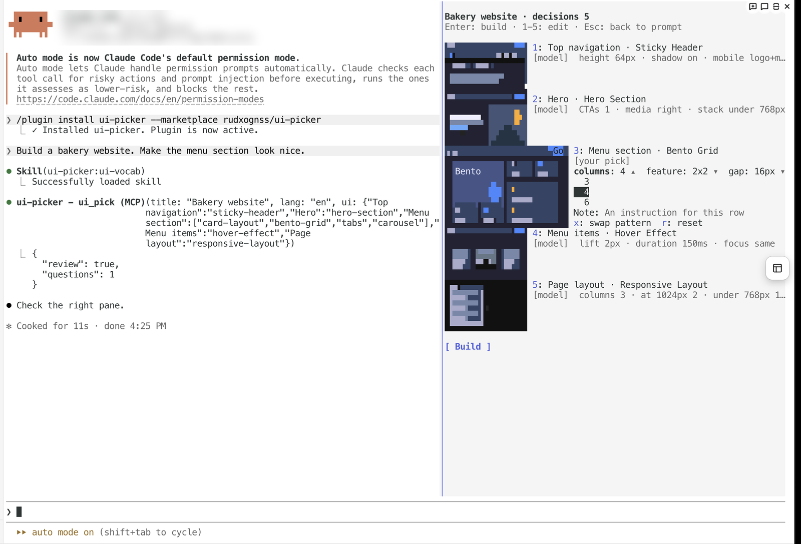
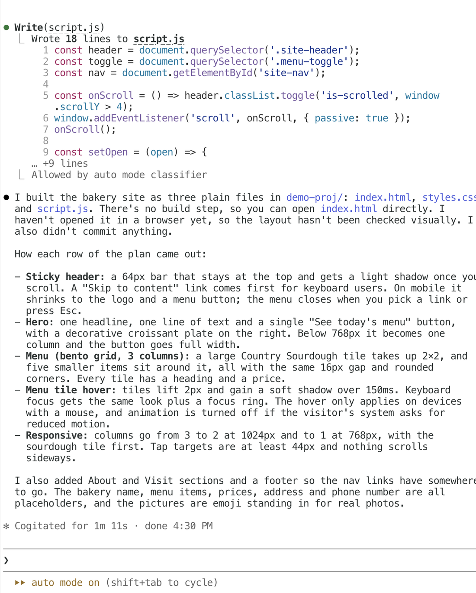
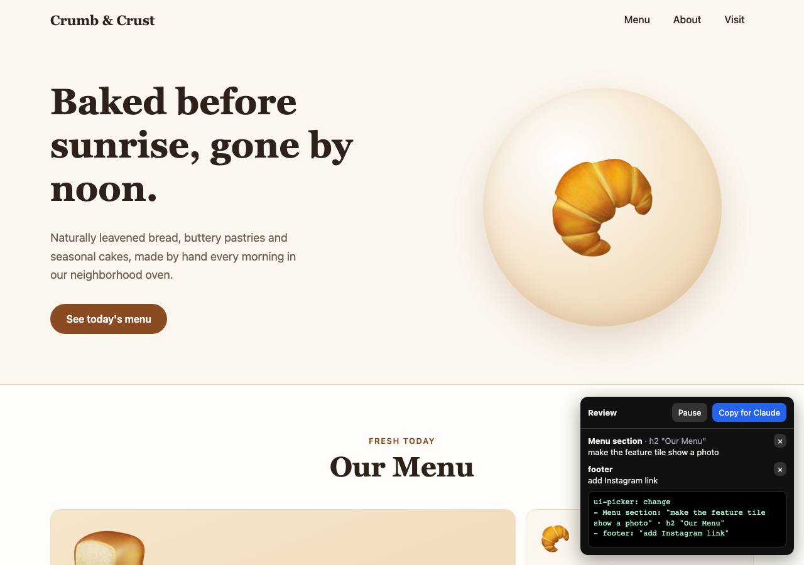
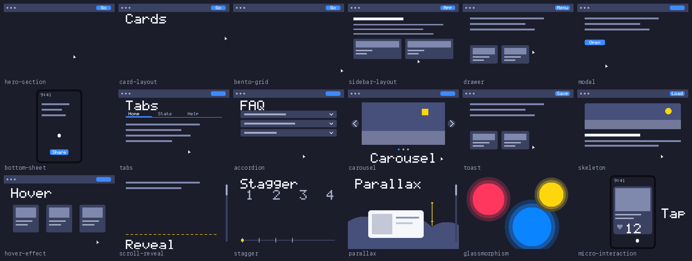

# ui-picker

A Claude Code plugin that asks before it builds UI. It names every area of your request with one of 25 UI terms, shows animated previews of the patterns that fit, asks only where the choice changes structure, lets you edit the numbers, and hands the model a one-screen spec you approved.

Works in any language: ask in English, Korean, Japanese or anything else and the pane answers in that language.



## Why

- You say "make the menu section look nice". Without ui-picker the model picks something. With it, you see Card Layout, Bento Grid, Tabs and Carousel moving side by side and press one key.
- It asks only when two or more patterns genuinely fit. Top navigation, hero, loading states and the like are decided for you and listed, not asked.
- Every row carries its default behavior, keyboard rules and mobile fallback, so the build is consistent without you spelling it out.
- The approved plan reaches the model as plain lines it cannot reinterpret: `- Menu section: Bento Grid (your pick) · cols 3`.

## Install

Inside Claude Code (2.1.303 or later, in a terminal):

```
/plugin install ui-picker --marketplace rudxognss/ui-picker
```

Pick a scope, press Enter. No restart.



Shell form: `claude plugin install ui-picker --marketplace rudxognss/ui-picker`.

Skill only, for any agent that reads `SKILL.md` (Cursor, Codex, Claude Code without the pane): `npx skills add rudxognss/ui-picker`. You get the 25 term cards and the ask-only-when-ambiguous planning; the plan prints as a table in chat instead of the pane.

한국어 안내: [README.ko.md](README.ko.md)

## Use

Ask for UI the way you normally would. In a terminal narrower than 144 columns the pane cannot open on its own: the animated previews open in your browser instead, the question comes in chat, a typed digit answers it, and `/ui-picker` opens the pane at any width.

```
Build a bakery website. Make the menu section look nice.
```

The model plans the page as areas and terms, then opens the pane:

```
⏺ ui-picker - ui_pick (MCP)(title: "Bakery website", lang: "en", ui: {
    "Top navigation": "sticky-header",
    "Hero": "hero-section",
    "Menu section": ["card-layout", "bento-grid", "tabs", "carousel"],   ← asked
    "Menu items": "hover-effect",
    "Page layout": "responsive-layout" })
  ⎿  { "review": true, "questions": 1 }

⏺ Check the right pane.
```

Press `2` for Bento Grid. The review board lists all five rows with a thumbnail, the pattern, who decided it, and the numbers. `3` opens a row; each number is a select, plus a note field.



Enter on `Build` sends the plan to the model as a user message:

```
ui-picker: build
- Top navigation: Sticky Header
- Hero: Hero Section
- Menu section: Bento Grid (your pick) · cols 3
- Menu items: Hover Effect
- Page layout: Responsive Layout
```

The model builds exactly that, and reports row by row.



Afterwards `/ui-picker` reopens the board. Change a number or swap a pattern and Enter sends only the changed rows as `ui-picker: change`.

### Review the draft in the browser

An HTML draft comes with a review overlay. Open it, click any part of the page, write what should change, press **Copy for Claude** and paste into Claude Code. Each plan row's root element is tagged with its area name, so the note lands on the right row; clicks inside a row also name the element.



```
ui-picker: change
- Menu section: "make the feature tile show a photo" · h2 "Our Menu"
- footer.site-footer: "add Instagram link"
```

The overlay is one script file (`ui-picker-review.js`) next to the HTML, no dependencies; notes survive a reload. Delete the script tag when the draft is final.

### Keys

| key | while asking | on the review board |
|---|---|---|
| `1`-`4` | pick that candidate | open or close row 1-9 |
| Enter | | `Build` (or `Send changes`); inside a row: confirm the select |
| `0` | | `Build` |
| `x` / `r` | | swap the pattern / reset the row |
| Esc | apply the recommended answers to the rest | keyboard back to the prompt; the pane stays |

Typing a digit into the prompt while a question is open counts as that pick. Typing anything else leaves the plan in the pane and lets the model answer you or re-plan.

## The 25 terms

| Layout | Component | Effect |
|---|---|---|
| Hero Section | Tabs | Hover Effect |
| Responsive Layout | Accordion | Scroll Reveal |
| Card Layout | Modal | Stagger |
| Bento Grid | Drawer | Smooth Transition |
| Sidebar Layout | Bottom Sheet | Glassmorphism |
| Sticky Header | Dropdown | Parallax |
| Split Layout | Tooltip | Scroll Snap |
| | Toast | Micro-interaction |
| | Carousel | |
| | Skeleton | |



Each term card in [skills/ui-vocab/terms.md](skills/ui-vocab/terms.md) holds plain-language aliases ("slides out from the side" is a Drawer), when it fits, the default behavior plus accessibility and responsive rules the build follows, the numbers you can edit, what to avoid, and the neighbor it is confused with.

## Languages

- English and Korean pane text is built in.
- Any other language: the model sends the pane text in that language with the same call. Term names are localized too (Drawer becomes ドロワー or 抽屉). Anything missing shows in English.
- The build message keeps English term names and keys in every language, so the generated code is the same everywhere.

## How it works

1. **Plan.** A UI request activates the `ui-vocab` skill. The model lists every area in page order as `area -> term id`; an area where 2-4 patterns fit becomes a question (max 3).
2. **Pick.** One `ui_pick` call opens the pane. Every candidate animates at once; a digit picks; Esc applies the recommendations.
3. **Review.** Rows show thumbnail, term, source tag (`model`, `your pick`, `recommended`, `changed`) and editable numbers.
4. **Build.** Enter sends the plan as a user message and closes the pane. Terms are final; listed numbers override the defaults; a note is your instruction.
5. **Change.** `/ui-picker` reopens the board; edited rows go out as `ui-picker: change`. In the browser, the review overlay turns clicks and notes into the same message.

Protocol details, message formats, preview internals and the live checklist: [docs/reference.md](docs/reference.md).

## Where it works

| Surface | Pane with previews | Skill only (plan as a table in chat) |
|---|---|---|
| Claude Code CLI in a terminal, 144 columns or wider | yes | |
| Narrower terminal | previews open in the browser, question in chat, digits answer; `/ui-picker` opens the pane | |
| Claude Code Desktop, VS Code panel, `claude -p`, SDK | | yes |

Previews are PNG frames in kitty-graphics terminals (Ghostty, kitty, WezTerm, Orca) and colored cell art elsewhere. Screenshots above: Orca 1.4 on macOS.

## Limitations

- Early-access mod API (`hooks.json` modules); may change between Claude Code releases.
- One `ui_pick` per request, 1-9 areas, max 3 questions, 2-4 candidates each.
- Editable numbers are the fixed steps of each term card; free text goes in the note.
- Languages other than English and Korean cost extra tokens per call for the pane text.
- Sends nothing anywhere. State lives in the plugin's session store.

## Repository layout

What the plugin runs is `.claude-plugin/`, `hooks/`, `skills/` and `types/`. Everything else is for people working on it: `tests/` (125 checks the plugin runner executes), `scripts/` (regenerates the preview frames), `docs/` (screenshots and the protocol reference), `tsconfig.json`.

## Develop

```sh
command claude plugin validate .
command claude plugin test .              # 125 tests
bun scripts/render-previews.ts --check    # PNG frames up to date
bun scripts/build-preview-html.ts --check # browser preview page up to date
```

## License

MIT
